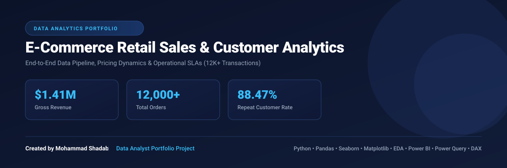

[](https://www.python.org/)
[](https://pandas.pydata.org/)
[](https://seaborn.pydata.org/)
[](https://matplotlib.org/)

# E-commerce Sales & Customer Analysis

This project looks at retail order value, product performance, customer purchasing patterns and order status across seven countries. I used Python for cleaning and exploratory analysis, MySQL for business queries, and Power BI for visualisation.

The repository also includes a standalone HTML dashboard and a revised report. Both use explicit metric definitions so that cancelled orders, repeat purchases and incomplete periods are not mistaken for realised revenue, retention or full-year growth.

## Start here

- [Interactive HTML dashboard](Dashboard/index.html) — download and open in a browser; no installation or internet required.
- [Analysis report — PDF](Report/Ecommerce_Analysis_Report.pdf)
- [Python notebook](Notebook/Ecommerce.ipynb)
- [12 SQL queries](SQL%20Script/E-Commerce%20Analytics%20Queries.sql) and [saved outputs](SQL%20Otputs/)
- [Existing Power BI dashboard PDF](Power%20BI%20Dashboard/Ecommerce.pdf) / [editable PBIX](Power%20BI/Ecommerce.pbix)

## Data and scope

| File | Contents |
| --- | --- |
| [Raw data](Raw%20Data/ecommerce_retail_transactions_raw.csv) | 12,180 rows, 13 columns; inconsistent labels, mixed date formats and missing values |
| [Clean data](Clean%20Data/ecommerce_retail_transactions_cleaned.csv) | 12,000 distinct order IDs, 17 columns and no missing cells |

Each clean record represents one order ID with one product entry. The fields include customer ID, order date, category, product, quantity, unit price in USD, discount, payment method, shipping location, status and rating. There are **8 categories, 7 countries and 3,374 customer IDs**.

The original dataset source and collection documentation are not included. Treat the file as a practice extract rather than verified current sales from a named retailer.

## Selected results

| Metric | Value | Definition |
| --- | --- | --- |
| Post-discount order value | **$1,408,524.91** | All statuses, including cancelled and returned orders |
| Average order value | **$117.38** | All-status value / 12,000 orders |
| Delivered order value | **$776,512.79** | Delivered records only |
| Delivered share | **54.82%** | 6,578 delivered orders / 12,000 orders |
| Repeat-customer share | **88.47%** | Customers with more than one order, all statuses |
| Delivered-only repeat share | **66.82%** | Customers with more than one delivered order / customers with a delivered order |

Electronics and Home & Kitchen contribute **46.83%** of all-status order value. This is a sales-value comparison, not a profit comparison. The repeat-customer figures describe the observed window; they do not establish loyalty, cohort retention or lifetime value.

### Reading the dates

The clean file stores dates in `DD-MM-YYYY`, but its mixed-format parsing appears to shift some raw day/month combinations. The new analysis joins records back to the first raw occurrence of each Order ID and applies these explicit rules:

- Year-first dates: `YYYY-MM-DD` or `YYYY/MM/DD`.
- Slash-separated year-last dates: `DD/MM/YYYY`.
- Dashed year-last dates: `MM-DD-YYYY`.
- Named months: `DD Mon YYYY`.

Under those assumptions, **865 dates differ**, and the range is **1 January 2024–30 June 2026**, rather than the stored range through 6 December 2026. The rules are inferred from the raw formats, not confirmed by the original data owner. Original CSVs are unchanged; [the date audit](Analysis/date_reconciliation.csv) lists every difference.

The dashboard lets you switch between **reconciled dates and stored dates**. Using the reconciled dates, January–June 2026 order value is **1.93% below January–June 2025**. Do not compare partial 2026 with a full calendar year.

## HTML dashboard


Five navigable pages cover:

1. **Overview** — order value, AOV, customers, monthly sums and category/market mix.
2. **Sales & markets** — monthly detail, products, categories and leading cities.
3. **Customers** — repeat-purchase share, purchase frequency, payment usage and a customer ledger.
4. **Operations** — order status, category cancellation/return shares and an order ledger.
5. **Data notes** — formulas, date assumptions and source limitations.

Global filters cover year, country, category, order-status scope and date basis. Category and market bars can be selected to filter the workspace. Ledgers support search, sorting and pagination. CSV export downloads the global filtered selection; ledger search only affects the table display. Print view prints the current page.

The dashboard embeds its data, styles and charts in `Dashboard/index.html`; it makes no external requests. GitHub normally shows HTML source rather than running it, so download the file or serve it locally. It is not a live sales feed.

## Existing analysis

The notebook fills missing discounts with zero, cities with Unknown and ratings with the median. It standardises country and payment labels, removes duplicate order IDs, adjusts quantities, and calculates pre- and post-discount amounts. Nine chart images are saved in `Images/`.

The SQL queries cover business totals, status mix, product/category performance, markets, payment methods, discount groups, repeat-customer spend and monthly growth. They use conditional aggregation, CTEs, `DENSE_RANK`, `SUM() OVER()` and `LAG`.

The existing Power BI project has five dashboard-page screenshots and a PDF export. These are separate from the new HTML dashboard; its measures and refresh behaviour have not been revalidated here.

## Running the project

### Open the HTML dashboard

Download `Dashboard/index.html` and open it directly in a modern browser. Or, from the repository root:

```bash
python -m http.server 8000
```

Then open `http://localhost:8000/Dashboard/` on your computer.

### Rebuild the revised analysis, report and dashboard

```bash
pip install -r requirements.txt
python Analysis/build_analysis.py
python Analysis/build_dashboard.py
python Analysis/build_report.py
```

These scripts recalculate metrics, create the date audit and report charts, embed the browser dataset, and build the PDF and Word report. They do **not** overwrite the original CSVs, existing SQL outputs, notebooks, Power BI files or presentations.

### Notebook and MySQL

The notebook uses pandas, matplotlib and seaborn. Update the Windows-specific input and export paths before running it. For the raw input, use `Raw Data/ecommerce_retail_transactions_raw.csv` relative to the repository root. The existing notebook date parser and monthly chart still need the corrections described below.

The SQL loading notebook needs SQLAlchemy, PyMySQL and a local MySQL database named `projects`; it creates `ecommerce_dataset`. Update connection details and preferably load the included clean CSV locally rather than depending on the remote URL. The loader uses `if_exists="replace"`, so do not point it at a table you need to preserve. Use MySQL 8 for the window-function queries.

## Known issues in the original analysis

- **Q3 status spelling:** the query filters `Canceled`, but the dataset uses `Cancelled`. Correct it and regenerate `03_top_5_products_revenue.csv`.
- **Mixed status scopes:** some queries include all statuses and others exclude cancelled/returned orders. Their totals are not directly comparable. Excluding those two statuses still includes pending and shipped orders.
- **Monthly chart aggregation:** the notebook's `seaborn.lineplot` uses transaction-level data without a sum estimator. Its default is a mean, not monthly total sales. The new report and HTML dashboard explicitly use monthly sums.
- **Quantity assumptions:** negative quantities become positive and zero becomes one. Confirm their original meaning before treating them as data-entry errors.
- **Ratings:** 6,150 raw ratings are missing. Median imputation limits the usefulness of rating-based conclusions.
- **Unsupported interpretations:** the available fields do not measure customer demographics, predicted CLV, price elasticity, profit, refund amounts or delivery SLAs. No fixed advertising increase or fulfilment investment is justified by these comparisons alone.

## Repository contents

```text
ecommerce-sales-customer-analysis/
├── Analysis/               Recalculation scripts, verified metrics, date audit and report charts
├── Clean Data/             Existing cleaned CSV
├── Dashboard/              Standalone HTML, source template and preview
├── Images/                 Nine original chart PNGs and banner
├── Notebook/               Original notebook and PDF export
├── Power BI/               Existing PBIX
├── Power BI Dashboard/     Five screenshots and dashboard PDF
├── Presentation/           Existing PowerPoint and PDF
├── Raw Data/               Original CSV
├── Report/                 Revised report, PDF and Word
├── SQL Otputs/             12 saved query outputs; existing folder spelling retained
├── SQL Script/             Query pack and MySQL loading notebook
├── requirements.txt
└── README.md
```

## Author

**Mohammad Shadab**

[LinkedIn](https://www.linkedin.com/in/mohammad-shadab-550aab24b) · [GitHub](https://github.com/Mohammadshadab1) · [Portfolio](https://myportfoliowebsite-lyart.vercel.app/) · [Email](mailto:jrshadab921@gmail.com)

